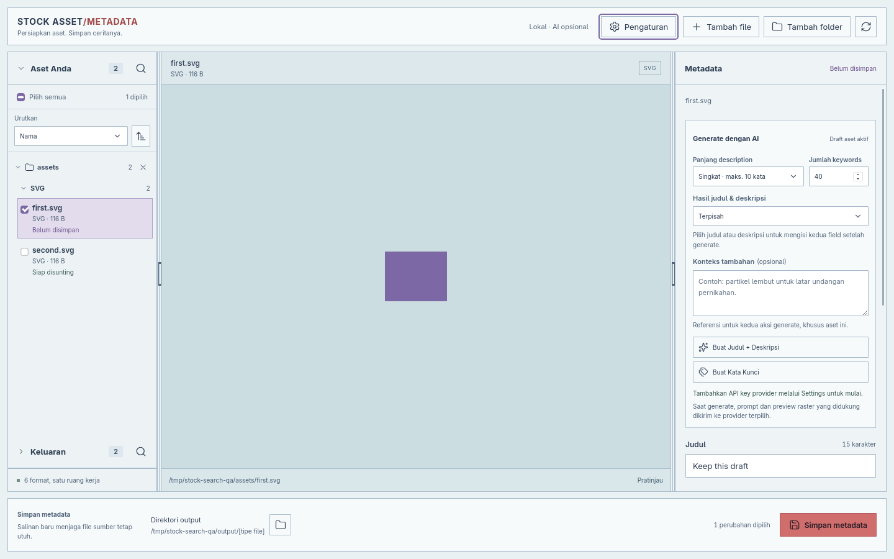

# Stock Asset Metadata

Aplikasi desktop lokal untuk membaca dan menyunting **title**, **description**, dan
**keywords** aset microstock. Dibangun dengan Tauri, Rust, dan TypeScript untuk
**Fedora 44 x86_64**, dengan target installer **Windows x64**.



## Fitur

- Edit metadata per file atau batch, dengan urutan keyword yang dapat diatur.
- Impor file/folder dan drag-and-drop, pencarian, sorting, serta preview aset.
- Generator judul, deskripsi, dan keyword dengan AI opsional; hasilnya dalam English.
- Riset keyword dari referensi gambar Pixabay, dengan pilihan lintas halaman dan penambahan ke draft aktif.
- Simpan salinan atau perbarui sumber dengan backup dan validasi metadata.
- Ekspor **CSV Shutterstock untuk video MP4/MOV**, berisi nama file, deskripsi,
  keyword, dan kategori untuk diimpor setelah video diunggah ke Shutterstock.
- Antarmuka Indonesia/English, tema light/dark, dan panel yang dapat diubah ukurannya.

Pemrosesan metadata berjalan lokal. Fitur AI mengirim permintaan ke provider
pilihan pengguna saat digunakan. Pencarian Pixabay mengirim teks query saat pengguna
menjalankan pencarian; file, path, dan metadata lokal tidak dikirim.

## Riset keyword Pixabay

Di bagian Keywords, pilih **Cari referensi Pixabay**, masukkan query English,
pilih tipe gambar, lalu tekan Cari atau Enter. Centang gambar yang relevan,
tinjau saran, centang keyword, lalu pilih **Tambahkan pilihan ke draft**.
Pilihan gambar bertahan lintas halaman. Query/filter baru mereset pilihan
setelah pencarian dijalankan; Kembali ke preview mengakhiri sesi riset.

Hitungan `n/total` menunjukkan frekuensi tag pada gambar yang dipilih, bukan
volume pencarian atau rekomendasi agency. Keyword lama mempertahankan teks dan
urutannya; duplikat dilewati. Penambahan hanya mengubah draft aset yang namanya
tercantum sebagai target. **Simpan metadata** tetap diperlukan. Generate Keywords
AI mengganti daftar keyword draft, termasuk tambahan Pixabay.

Fitur membutuhkan internet dan API key pribadi dari
[halaman API Pixabay](https://pixabay.com/api/docs/). Buka **Pengaturan → Pixabay**,
isi **API key Pixabay**, lalu klik **Simpan pengaturan**. Pencarian langsung aktif
tanpa rebuild atau restart. Menyimpan key tidak menghubungi Pixabay; key yang
salah dilaporkan saat pencarian dijalankan.

Key tersimpan di credential store OS, terpisah dari key AI. Nilainya tidak dibaca
kembali ke input. Input kosong mempertahankan key lama; **Hapus key tersimpan**
baru berlaku setelah Simpan pengaturan, sedangkan Kembali membatalkan perubahan.
Penghapusan menonaktifkan pencarian baru dan mempertahankan referensi/draft yang
sudah ada. Jika penyimpanan salah satu bagian gagal, status menyebut bagian
berhasil/gagal dan mempertahankan input bagian yang gagal untuk dicoba kembali.

Key tidak disertakan dalam binary dan build RPM/Windows tidak memerlukan secret
Pixabay. Cache hasil disimpan selama 24 jam di direktori cache aplikasi
`pixabay-search/`, terpisah dari cache preview; cache memuat query dan data hasil,
tanpa key atau bytes gambar. Tidak ada pencarian otomatis, prefetch, retry
otomatis, atau unduh gambar penuh. Hanya thumbnail sementara dari CDN Pixabay
yang ditampilkan; sumber dan kontributor dicantumkan, dengan tautan melalui OS.

Referensi/tag bukan validasi lisensi atau hak submission microstock. Ikuti
[ketentuan API Pixabay](https://pixabay.com/api/docs/) dan
[lisensi konten Pixabay](https://pixabay.com/service/license-summary/).

## Dukungan format

| Format | Metadata | Preview |
| --- | --- | --- |
| JPG/JPEG | XMP | Gambar dengan orientasi EXIF |
| PNG | XMP | Gambar dengan transparansi |
| SVG UTF-8 | XMP, title, dan description | Render SVG |
| EPS ASCII/biner | XMP | TIFF tertanam atau Ghostscript |
| MP4/MOV | XMP dan ekspor CSV Shutterstock | Frame statis melalui FFmpeg |

Preview video bukan pemutar video. Kompatibilitas pembacaan metadata mengikuti
portal tujuan; XMP tertanam tidak menjamin metadata terbaca di semua agency.

Header preview menampilkan resolusi sumber serta tanggal dibuat/diubah dari
filesystem dalam zona waktu lokal. JPG/PNG dan video memakai px, SVG memakai
ukuran kanvas intrinsik dalam px, dan EPS memakai BoundingBox dalam pt.
Resolusi video memerlukan `ffprobe` di PATH (disertakan dalam distribusi FFmpeg).
Nilai yang tidak dapat dibaca menampilkan “Tidak tersedia”; penyuntingan metadata
tetap tersedia bila hanya pembacaan resolusi atau preview yang gagal.
Pembacaan ukuran SVG dan bagian PostScript EPS dibatasi 64 MiB; EPS tanpa
BoundingBox yang valid menampilkan “Tidak tersedia”.

## Build

Prasyarat: **Node.js 22.12+**, npm, dan **Rust stable**. Dari direktori project
pada Fedora 44, jalankan:

```bash
sudo dnf install webkit2gtk4.1-devel openssl-devel librsvg2-devel libxdo-devel gcc-c++ make ghostscript ffmpeg-free
npm ci
npm run bundle
```

Hasil RPM berada di `src-tauri/target/release/bundle/rpm/`.

Build installer Windows di PowerShell: `.\scripts\build-windows.ps1`.
Prasyarat dan petunjuk lengkap tersedia di [panduan Windows](docs/WINDOWS.md).

## Instalasi RPM

Unduh file `.rpm` dan pasangan `.rpm.sha256` dari
[GitHub Releases](https://github.com/colozha/stock-asset-metadata/releases).
Di folder unduhan, verifikasi checksum lalu instal paket (sesuaikan nama file):

```bash
sha256sum --check 'Stock Asset Metadata-0.1.1-1.x86_64.rpm.sha256'
# Lanjutkan setelah hasil verifikasi OK.
sudo dnf install './Stock Asset Metadata-0.1.1-1.x86_64.rpm'
```

DNF memasang dependensi runtime, termasuk Ghostscript dan FFmpeg. RPM belum
ditandatangani. Setelah instalasi, buka **Stock Asset Metadata** dari menu aplikasi.

## Instalasi Windows

Unduh `*_x64-setup.exe` dan checksum dari GitHub Releases, verifikasi checksum,
lalu jalankan installer. WebView2 dipasang bila diperlukan; Node.js/Rust tidak
dibutuhkan. Lihat [petunjuk instalasi dan dependensi preview](docs/WINDOWS.md).
Push tag versi membangun RPM dan installer Windows pada Release yang sama.
